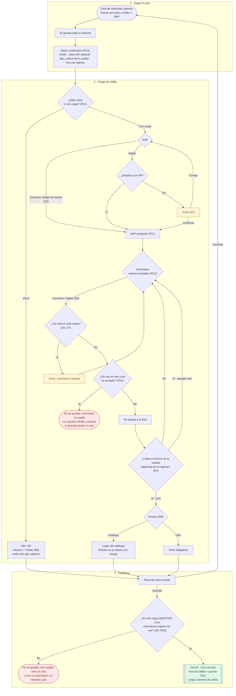
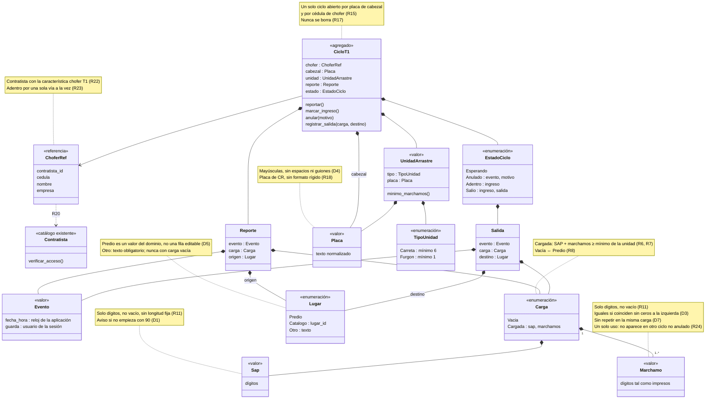
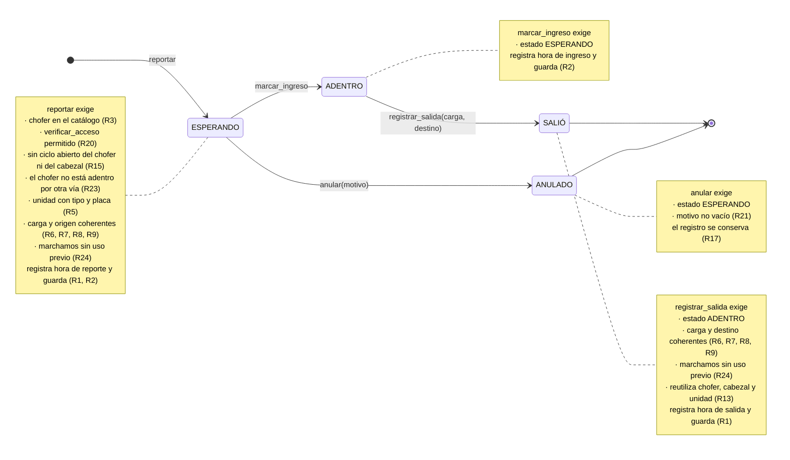
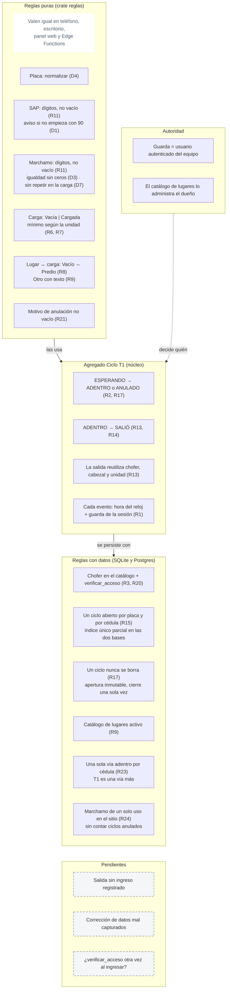

# Módulo "Control T1"

Estado: **dominio casi cerrado — sin código todavía** (2026-11-23). Este
documento se fue cerrando por rondas con el dueño. Lo marcado como
**pendiente** todavía no es regla.

## Contexto

**T1** es como se llama a los cabezales que transportan producto entre la
planta de producción y las bodegas, internas y externas.

Hoy cada movimiento se registra en **dos pasos**: el guarda llena a mano una
hoja en el puesto de control y después alguien pasa esos datos a un Excel. El
objetivo del módulo es **dejarlo en un solo paso**: el guarda registra desde el
teléfono, en el momento, con lectura de placa, código de barras y marchamos.
El escritorio da paridad operativa como respaldo.

### Lo que hoy produce el doble paso

Columnas de la hoja actual: `FECHA`, `HORA`, `OPERADOR`, `CABEZAL`,
`CARRETA`, `MARCHAMOS`, `MOVIMIENTO`, `DESTINO`, `TRANSPORTE`, `GUARDIA`.

Errores que se ven en una muestra real (filas 1076–1087):

| Error | Ejemplo | Qué lo evita en el módulo |
|---|---|---|
| Un dato en la columna equivocada | Carreta `996137`, que es el marchamo `996137-38` | Lectura por cámara y validación de cada campo |
| Destino mal escrito | `PREDO` en vez de `PREDIO` | Catálogo de lugares |
| Horas fuera de orden | 03:55, 03:35, 03:58 | La hora la pone el reloj de la aplicación |
| Carreta distinta entre ingreso y salida (error de digitación confirmado por el dueño) | `36509` → `36209` (filas 1076 y 1082) | La salida reutiliza la unidad de arrastre del ingreso (R13) |

## T1 es un módulo propio

T1 **no comparte dominio** con Rutas, Proveedores, Visitas ni Por correo:
tiene su propia tabla, sus reglas y su pantalla. Del resto de la aplicación
solo usa el **catálogo de contratistas y empresas** (para el chofer) y
**componentes técnicos** de lectura (ver "Reutilización técnica").

## Lenguaje del dominio

| Término | Significado |
|---|---|
| **T1** | Cabezal que transporta producto entre la planta y las bodegas |
| **Chofer** | Quien maneja el cabezal. Es un contratista de una empresa que ya existe en el catálogo |
| **Cabezal** | Tractocamión. Se identifica **solo por su placa** |
| **Unidad de arrastre** | **Carreta** o **furgón**, con su placa |
| **Marchamo** | Sello físico que asegura la carga para que no se manipule. Lleva un número impreso (ej. `0996362`) |
| **SAP** | El número que está **bajo el código de barras** del documento de transporte; hoy empieza con `90` (ej. `901025393`). **No** confundir con el campo "Documento SAP" impreso en el mismo papel, que es otro número |
| **Lugar** | De dónde viene (en el ingreso) o a dónde va (en la salida). Sale del catálogo, o es **Otro** con el lugar escrito para un caso puntual |
| **Predio** | El lugar de donde vienen y a donde van los cabezales **vacíos** |
| **Ciclo T1** | Lo que va del reporte de un cabezal a su salida |
| **Reporte** | El chofer llega al puesto de control y se anuncia; espera a que lo llamen |
| **Anulación** | Cierre de un reporte que nunca entró. No borra nada: el registro queda, con el motivo |
| **Ingreso / Salida** | Los dos únicos movimientos |
| **Vacío / Cargado** | Estado de la carga en cada movimiento. Se registran solo los documentos (SAP y marchamos), **no** qué producto se transporta |
| `SM` / `SD` | "Sin marchamo" / "Sin documento": cómo se muestra un movimiento **vacío** |

## Ciclo de vida

```
                 ┌──(lo llaman)──► Adentro ──► Salió
Reportado ───────┤
                 └──(no entra)───► Anulado (con motivo)
```

1. **Reporte.** El chofer se reporta. El guarda captura chofer, cabezal,
   unidad de arrastre, carga de ingreso y origen mientras el chofer espera, y
   se abre el ciclo **sin hora de ingreso**.
2. **Ingreso.** Cuando lo llaman y entra, el guarda lo marca: en ese momento
   se coloca la **hora de ingreso** (la que hoy va en la columna `HORA`). Desde
   ahí el cabezal aparece en la lista de **cabezales adentro**.
3. **Anulación.** Si se reportó y no entró, el guarda **anula** el reporte
   indicando el motivo. Nunca se borra: queda el registro de que se reportó,
   que no entró y por qué.
4. **Salida.** El guarda elige el cabezal en la lista de adentro y responde
   **una sola pregunta: ¿sale vacío o con carga?** Chofer, cabezal y unidad de
   arrastre se reutilizan del ingreso; no se vuelven a capturar.
   - **Vacío:** no se captura nada más. Queda `SM`/`SD` y el destino es
     **Predio** automáticamente.
   - **Con carga:** se capturan solo **marchamos, SAP y destino**.

   En los dos casos la fecha, la hora y el guarda que registra los pone la
   aplicación. La salida **cierra el ciclo**.

Un cabezal puede **entrar vacío o cargado** y **salir con otra carga o
vacío**: la carga de ingreso y la de salida son independientes.

## Diagramas de flujo

Muestran reglas confirmadas y derivadas. Convención de colores: **rojo**,
no se registra; **amarillo**, aviso que el guarda puede confirmar;
**verde**, cambio de estado del ciclo; **borde punteado**, propuesta
todavía no confirmada.

### Reporte e ingreso

```mermaid
flowchart TD
    classDef rechazo fill:#fde8e8,stroke:#c0392b,color:#7b241c
    classDef aviso fill:#fff4d6,stroke:#b9770e,color:#7e5109
    classDef estado fill:#e3f4e8,stroke:#1e8449,color:#145a32
    classDef propuesta stroke-dasharray:6 4,stroke:#566573

    subgraph F1["1 · Chofer"]
        A(["El chofer se reporta<br/>en el puesto de control"]) --> B{"¿Cómo se identifica?"}
        B -- "Escanear cédula" --> B1["OCR de cédula<br/>(lector existente)"]
        B -- "Buscar" --> B2["Buscar por nombre o cédula<br/>entre los choferes T1 (R22)"]
        B1 --> C{"¿La cédula está<br/>en el catálogo?"}
        B2 --> C
        C -- No --> C1["Alta de contratista<br/>con empresa existente (R3)"] --> C
        C -- Sí --> D{"verificar_acceso<br/>misma regla que contratistas (R20)"}
        D -- "Empresa inactiva · sin acceso ·<br/>PRAIND no registrado · vencido" --> X1(["Rechazado: se muestra el motivo<br/>no se crea ningún registro"]):::rechazo
        D -- "PRAIND por vencer" --> D1["Aviso: vence en N días<br/>el guarda continúa"]:::aviso
        D -- Permitido --> E{"¿El chofer tiene un ciclo<br/>abierto? (R15)"}
        D1 --> E
        E -- Sí --> X2(["Rechazado: ya está esperando o adentro<br/>se muestra ese ciclo"]):::rechazo
        E -- No --> E2{"¿Está adentro por otra vía?<br/>contratista · proveedor · por correo (R23)"}
        E2 -- Sí --> X6(["Rechazado: ya está adentro<br/>como contratista, proveedor o por correo"]):::rechazo
    end

    subgraph F2["2 · Vehículo"]
        E2 -- No --> F{"Placa del cabezal (R4)"}
        F -- Escanear --> F1x["Lector de placas de CR"]
        F -- Digitar --> F2x["Teclado"]
        F1x --> F3["Normalizar: mayúsculas,<br/>sin espacios ni guiones (D4)"]
        F2x --> F3
        F3 --> G{"¿El cabezal tiene un ciclo<br/>abierto? (R15)"}
        G -- Sí --> X3(["Rechazado: el cabezal ya está<br/>esperando o adentro"]):::rechazo
        G -- No --> H["Tipo de unidad de arrastre (R5)<br/>Carreta → mínimo 6 · Furgón → mínimo 1"]
        H --> H1["Placa de la unidad<br/>escanear o digitar, normalizada (D4)"]
    end

    subgraph F3x["3 · Carga de ingreso"]
        H1 --> I{"¿Viene vacío<br/>o cargado?"}
        I -- Vacío --> J["SM / SD<br/>Origen = Predio (R8)<br/>no se pide nada más"]
        I -- Cargado --> K{"SAP"}
        K -- "Escanear código de barras (D2)" --> K3["SAP aceptado<br/>solo dígitos, sin longitud fija (R11)"]
        K -- Digitar --> K1{"¿Empieza con 90?"}
        K1 -- Sí --> K3
        K1 -- No --> K2["Aviso: no parece el número<br/>del código de barras (D1)"]:::aviso
        K2 -- "Confirma" --> K3
        K2 -- "Corrige" --> K
        K3 --> L{"Marchamo<br/>número completo (R12)"}
        L -- Escanear --> L1["OCR de marchamo"]
        L -- Digitar --> L2["Propone el número anterior;<br/>se corrigen los últimos dígitos (D6)"]
        L1 --> L3{"¿Ya está en esta carga?<br/>compara sin ceros a la izquierda (D3, D7)"}
        L2 --> L3
        L3 -- Sí --> L4["Aviso: marchamo repetido"]:::aviso --> L
        L3 -- No --> L6{"¿Se usó en otro ciclo<br/>no anulado? (R24)"}
        L6 -- Sí --> X7(["No se acepta: marchamo ya usado<br/>se muestra dónde y cuándo<br/>el guarda escala el caso"]):::rechazo
        L6 -- No --> L5["Se agrega a la lista"]
        L5 --> M{"¿Llegó al mínimo<br/>de la unidad? (R7)"}
        M -- No --> L
        M -- "Sí · agregar otro" --> L
        M -- "Sí · listo" --> N{"Origen (R9)"}
        N -- Catálogo --> N1["Lugar del catálogo<br/>(Predio no se ofrece con carga)"]
        N -- Otro --> N2["Texto obligatorio"]
    end

    subgraph F4["4 · Confirmar, esperar e ingresar"]
        J --> O["Resumen para revisar<br/>todo editable antes de guardar"]
        N1 --> O
        N2 --> O
        O --> O0{"Al guardar: ¿siguen libres el chofer,<br/>el cabezal y los marchamos? (R15, R23, R24)<br/>otro equipo pudo registrarlos"}
        O0 -- No --> X4(["No se guarda: otro equipo<br/>lo registró primero"]):::rechazo
        O0 -- Sí --> O1[["Ciclo creado · ESPERANDO<br/>hora de reporte + guarda (R1, R2)"]]:::estado
        O1 --> O2["Aparece en la lista de reportados"]
        O2 --> P{"¿Lo llaman?"}
        P -- Entra --> P1{"verificar_acceso otra vez<br/>(el acceso pudo cambiar mientras esperaba)"}:::propuesta
        P1 -- Denegado --> X5(["No entra: se muestra el motivo<br/>el ciclo sigue ESPERANDO para anularlo"]):::rechazo
        P1 -- Permitido --> Q[["INGRESO · ADENTRO<br/>hora de ingreso + guarda (R2)"]]:::estado
        P -- "No entra" --> R["Motivo: texto libre<br/>obligatorio (R21)"]
        R --> R1[["ANULADO<br/>hora + guarda + motivo<br/>el registro queda (R17)"]]:::estado
    end
```



### Salida



## Modelo conceptual

```
Carga = Vacía
      | Cargada { sap, marchamos: [al menos uno] }

Lugar = Predio                      (valor propio del dominio, no una fila editable)
      | Catalogo(lugar_id)          (bodegas y plantas que administra el dueño)
      | Otro(texto)                 (caso puntual, texto obligatorio)

Ciclo T1
  chofer            contratista del catálogo          ┐ se capturan una vez
  cabezal           placa                             │ (en el reporte) y la
  unidad_arrastre   { tipo: Carreta | Furgón, placa } ┘ salida los reutiliza
  reporte           { fecha_hora, guarda, carga: Carga, origen: Lugar }
  estado
    = Esperando                                   (reportado, todavía afuera)
    | Anulado  { fecha_hora, guarda, motivo }
    | Adentro  { ingreso: { fecha_hora, guarda } }
    | Salió    { ingreso: { fecha_hora, guarda },
                 salida:  { fecha_hora, guarda, carga: Carga, destino: Lugar } }
```

- Con `Carga` como tipo de dos variantes, es **imposible** registrar
  marchamos sin SAP, SAP sin marchamos o una lista de marchamos vacía. Es el
  mismo criterio que ya usa el proyecto con `SalidaRegistroIngreso`.
- Con `estado` como un solo tipo, es imposible un ciclo anulado que además
  tenga ingreso, una salida sin ingreso o una salida a medias (con hora pero
  sin destino, por ejemplo). Fecha y guarda de cada evento van juntos o no
  van.
- Cada evento guarda **su propio guarda** (id + nombre): quien recibe el
  reporte, quien marca el ingreso, quien anula y quien registra la salida
  pueden ser personas distintas (cambio de turno).

## Reglas

### Confirmadas por el dueño

| # | Regla |
|---|---|
| R1 | Solo hay dos movimientos: **ingreso** y **salida**. La fecha y hora las pone el reloj de la aplicación; no se editan. El guarda es el usuario de la sesión |
| R2 | El chofer **se reporta primero**: el ciclo se abre al reportarse y la **hora de ingreso** se coloca recién cuando entra |
| R3 | El chofer es un **contratista** de una empresa que ya existe en el catálogo |
| R4 | El cabezal se identifica **solo por su placa**. Los números de unidad que aparecen en la hoja (`1`, `10`, `11`, `46`) se ignoran |
| R5 | La unidad de arrastre es una **carreta** o un **furgón**, con su placa. **El guarda elige el tipo** en el reporte, porque de él depende el mínimo de marchamos |
| R6 | Una carga **cargada** lleva SAP y marchamos; una carga **vacía** no lleva ninguno de los dos (`SM`/`SD`). No se anota qué producto se transporta |
| R7 | Mínimo de marchamos de una carga cargada: **carreta ≥ 6**, **furgón ≥ 1** |
| R8 | **Vacío ⇔ Predio**: el vacío viene del predio o va al predio |
| R9 | El lugar sale de un **catálogo que administra el dueño**, más la opción **Otro** con el lugar escrito para un caso puntual |
| R10 | El SAP es el número **bajo el código de barras** del documento (hoy empieza con `90`) |
| R11 | **Sin longitud fija** para SAP ni marchamos: la cantidad de dígitos puede crecer o ser menor. Solo se exige que sean dígitos y que no estén vacíos |
| R12 | Cada marchamo se registra con su **número completo**, uno por uno. No se capturan rangos: hoy se anotan así por espacio en la hoja, pero los números pueden **saltarse** (no siempre son consecutivos) |
| R13 | La salida **reutiliza chofer, cabezal y unidad de arrastre** del ingreso |
| R14 | Al salir se pregunta **¿vacío o con carga?** Vacío: `SM`/`SD` y destino Predio, sin capturar nada más. Con carga: solo marchamos, SAP y destino |
| R15 | **No puede haber dos ciclos abiertos** (esperando o adentro) para la **misma placa de cabezal** ni para la **misma cédula** de chofer |
| R16 | El chofer **no lleva gafete** |
| R17 | Un reporte que no entra **se anula con un motivo**; nunca se borra |
| R18 | Las placas (cabezal y unidad de arrastre) son **placas de Costa Rica**; se **escanean** con el lector de placas o se **digitan a mano** |
| R19 | La exportación sigue **el mismo patrón** que las otras vistas de ingresos |
| R20 | El chofer pasa **la misma validación de ingreso que cualquier contratista**: se reutiliza `domain::acceso::verificar_acceso` tal cual (empresa inactiva, acceso negado, PRAIND no registrado, vencido y próximo a vencer, según su tipo de ingreso y si es personal de ruta). No hay reglas propias de T1 para esto. El gafete no se pide (R16): esa exigencia vive fuera de `verificar_acceso`, en el registro de entrada de contratistas, así que no hay nada que desactivar |
| R21 | El motivo de anulación es **texto libre y obligatorio** |
| R22 | El chofer vive en el **mismo catálogo de contratistas**, con la característica **chofer T1** (mismo precedente que "personal de ruta"). No hay tabla aparte. La característica solo **filtra** (buscador del reporte T1, pantalla Contratistas); no cambia ninguna regla |
| R23 | **Una sola vía por persona**: T1 es una vía más (`ViaIngreso`). Un chofer con un ciclo T1 abierto (esperando o adentro) no puede estar adentro a la vez como contratista, proveedor o por correo, y al revés |
| R24 | **Marchamo de un solo uso**: un número de marchamo (comparado según D3) no puede aparecer en las cargas de dos ciclos distintos del sitio, ni repetirse entre la carga de ingreso y la de salida del mismo ciclo. Si aparece, **no se acepta** y se muestra dónde y cuándo se usó, para que el guarda escale el caso |

### Derivadas (revisar con el dueño)

| # | Regla | De dónde sale |
|---|---|---|
| D1 | Un SAP tecleado a mano que **no empiece con `90`** muestra un **aviso** ("no parece el número del código de barras, ¿es correcto?"), **no un bloqueo**. Atrapa el error de copiar el "Documento SAP" del mismo papel (ej. `7144455713`) sin volver rígido el formato | Lo más fácil de confundir en el documento de ejemplo; R11 |
| D2 | El SAP se lee del **código de barras**, no por OCR: es exacto | El documento lo trae en código de barras |
| D3 | El marchamo se guarda **tal como está impreso** (`0996362`) y se compara **sin ceros a la izquierda**, así `996362` y `0996362` son el mismo | La hoja anota sin el cero; el marchamo lo trae |
| D4 | La placa se guarda **normalizada** (mayúsculas, sin espacios ni guiones), tanto la escaneada como la digitada, para que R15 compare igual `C-179371`, `c 179371` y `C179371`. Sin formato rígido, igual que R11 | R15 y R18 |
| D5 | **Predio** es un **valor propio del dominio** (`Lugar::Predio`), no una fila del catálogo: así R8 y R14 se verifican sin consultar la base y nadie puede desactivarlo ni renombrarlo. El catálogo solo tiene los demás lugares. Un movimiento con **Otro** siempre es cargado | R8, R9, R14 |
| D6 | Al teclear varios marchamos, el siguiente campo puede **proponer el número anterior** para que solo se corrijan los últimos dígitos. Es ayuda de captura: el número se guarda completo igual | Los marchamos de una misma carga comparten el inicio (R12) |
| D7 | Los marchamos de **una misma carga no se repiten** (comparados según D3) | Una lista de sellos físicos distintos |
| D8 | Al guardar el reporte se **vuelven a comprobar R15, R23 y R24**, y al guardar la salida, que el ciclo **siga adentro** y R24: otro equipo pudo registrar el mismo cabezal o cerrar el ciclo mientras el guarda capturaba | Varios equipos por sitio (`docs/auditorias/revision-carreras-2026-10-04.md`) |
| D9 | Los marchamos de un ciclo **anulado no cuentan** para R24: si el camión se reportó, no entró y vuelve después con la misma carga sellada, se acepta | R17 + R24 |
| D10 | R24 vale **dentro del sitio**. El día que se crucen envíos entre sitios, que el mismo marchamo salga de un lugar y entre en otro es justo lo esperado | Ver "A futuro" |
| D11 | R24 compara por número sin ceros a la izquierda (D3) y sin distinguir tipo de marchamo. Si un día dos tipos comparten numeración, habrá que guardar el tipo y comparar por tipo y número | R24; existen varios tipos de marchamo |

### A futuro (fuera de alcance por ahora)

- **Cruce de envíos entre sitios**: lo que sale de un lugar debe llegar al
  otro con el mismo SAP y los mismos marchamos. Hoy T1 solo se usa en este
  sitio, así que no aplica todavía; el modelo no debe impedirlo.

## Diagramas de reglas del dominio

### Modelo del dominio e invariantes

El ciclo T1 es el **agregado**: toda modificación entra por sus cuatro
operaciones y nunca se edita una parte suelta. Las notas amarillas son las
invariantes de cada pieza.



### Máquina de estados con sus condiciones



### Dónde se aplica cada regla

Mismo criterio que `docs/arquitectura/reglas-compartidas.md`: las reglas de
**criterio** (¿el dato es válido?) van al crate `reglas` para que valgan igual
en todas partes; las que necesitan **ver datos** (ciclo abierto, catálogo)
van donde están los datos; las de **autoridad**, en la sesión y la RLS.



## Reutilización técnica

| Necesidad | Componente existente |
|---|---|
| Chofer | Catálogo de contratistas y empresas; OCR de cédula (`mobile/rust-core/src/lectura_documentos/`) |
| SAP | Lector de códigos de barras de ML Kit, ya en la app (`barcode-scanning`, usado por `EscanerQr.kt`) |
| Placa de cabezal y de unidad de arrastre | Lector de placas de Costa Rica de `lectura_documentos/vehiculo.rs`. Hoy se llama "de ruta" por historia: se saca a un lector genérico para que T1 no dependa de nada de Rutas |
| Marchamo | **Nuevo**: OCR de solo dígitos, impreso en vertical sobre plástico curvo, con recuadro guía vertical |
| Exportación | El mismo mecanismo de las otras vistas de ingresos (selección de columnas y `.xlsx` del filtro vigente) |

## Pendientes

1. **Salida sin ingreso registrado** (no debería pasar; el dueño pidió
   pensarlo bien).
   Cuándo puede ocurrir:
   - **Arranque del módulo:** los cabezales que ya están adentro ese día.
   - **Olvido:** el guarda no registró el reporte o el ingreso.

   Opciones:
   - **A. Bloquear:** obliga a registrar ahora un reporte e ingreso con la
     hora actual. El historial queda con una hora de ingreso falsa.
   - **B. Salida marcada "sin ingreso":** se registra la salida con su hora
     real y el ciclo queda marcado como anomalía, visible en historial y
     exportación. No inventa horas.
   - **C. Ingreso tardío declarado:** el guarda escribe la hora en que entró,
     marcada como declarada. Contradice R1 (la hora no se edita).

   Inclinación inicial: **B** para el olvido, más una **carga inicial** el día
   del arranque (registrar a los que ya están adentro, marcados como "previos
   al sistema").
2. **¿Se repite `verificar_acceso` al marcar el ingreso?** Propuesta: sí. El
   reporte es solo el aviso de llegada; el ingreso es la entrada real, y entre
   uno y otro pudieron negarle el acceso o vencerle el PRAIND (por ejemplo, a
   medianoche). Si se deniega, el ciclo sigue ESPERANDO para anularlo con su
   motivo.
3. **Corrección de datos mal capturados:** el modelo no edita nada (las
   horas no se tocan y solo se anula un reporte que no entró). ¿Qué hace el
   guarda si descubre una placa o un SAP mal digitado con el cabezal ya
   adentro? Opción natural, igual que con contratistas: una corrección
   auditada (quién, cuándo, valor anterior y nuevo) solo para los campos de
   texto, nunca para las horas ni el estado.
